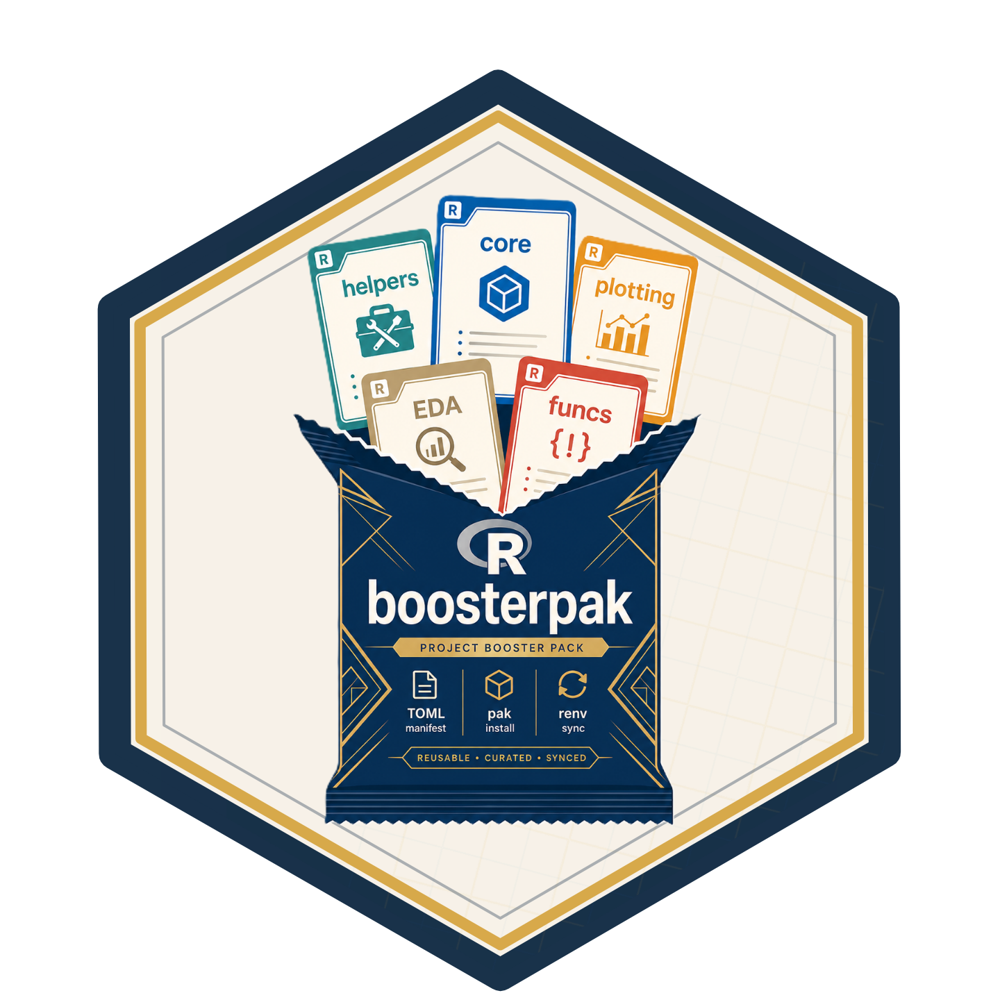
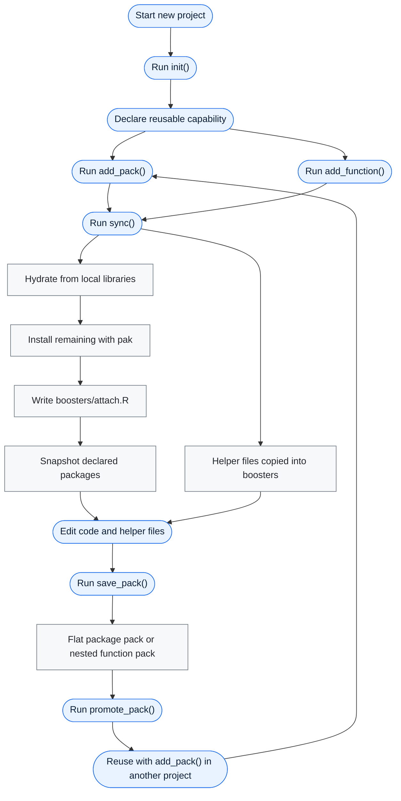

# boosterpak



`boosterpak` installs reusable R project packs: typed bundles of package dependencies, optional source specs, startup attachment intent, and helper-function sidecars that make a project usable without turning it into a package. It is less than a package, but more than a fistful of copied files.

`boosters.toml` is the project-local control file for those packs. It is not a general dependency-manifest standard and `boosterpak` does not depend on one. `pak` remains the installer, `renv` remains the lockfile and default project-library layer, and `boosterpak` sits above them as a small capability-bundle layer for reusable setup conventions. Existing projects can instead apply packs to an active user or site library without creating a project-local `renv` environment.

Use `boosterpak` when the reusable thing is not just "these packages", but "these packages plus the helper functions, attachment choices, and setup conventions that make this kind of project ready to work in."

## 1. Install pak

``` r
install.packages("pak")
```

## 2. Install boosterpak

``` r
pak::pkg_install("seanthimons/boosterpak")
```

## 3. Initialize the project

For a project stored in OneDrive or another synchronized folder, keep its
device-specific package library outside the project. Open the user-level
`.Renviron` file:

``` r
file.edit(path.expand("~/.Renviron"))
```

Add this line on Windows, then fully restart R:

``` text
RENV_PATHS_LIBRARY_ROOT="${LOCALAPPDATA}/R/cache/R/renv/library"
```

Confirm the path before initialization:

``` r
renv::paths$library(project = ".")
```

`renv` adds project-, platform-, and R-version-specific directories beneath
that root. The package library therefore stays local to the device, while the
small `renv/` bootstrap directory and `renv.lock` remain with the project so it
can be restored elsewhere. Keep `library = "renv"` in `boosters.toml`; no
boosterpak-specific path setting is required. Do not relocate the bootstrap
directory with `RENV_PATHS_RENV`, because boosterpak expects
`renv/activate.R` inside the project. See the
[`renv` path documentation](https://rstudio.github.io/renv/reference/paths.html)
for other platforms and path controls.

``` r
boosterpak::init(renv = "yes", rprofile = "yes")
```

`init()` writes `boosters.toml`, creates `boosters/packs/`, optionally writes `air.toml`, manages the recommended `.Rprofile` startup hook, and can initialize project-local `renv`. It also upgrades default-like CRAN mirrors to use Posit Package Manager for faster binary installs when available, including `@CRAN@`, common CRAN cloud mirrors, and mirrors listed in `options(boosterpak.default_cran_mirrors = c(...))` or `BOOSTERPAK_DEFAULT_CRAN_MIRRORS`; matching `.Rprofile` repository setup is written when `rprofile = "yes"`. On glibc Linux, that setup also switches to Posit's portable Linux binaries so distributions Package Manager does not list, such as Fedora, install binaries instead of compiling from source; see [Linux Binary Packages](#linux-binary-packages). The startup setup also enables the `renv` pak backend and asks R package installs to avoid compiling from source when binaries are available. With `renv = "yes"`, it bootstraps `renv`, `pak`, and `boosterpak` into the project library and snapshots those workflow packages before any restart is needed.

## 4. Sync the project

``` r
boosterpak::sync()
```

## Linux Binary Packages

CRAN publishes only source packages for Linux. Posit Package Manager builds
Linux binaries from them, but serves them from distribution-specific URLs such
as `https://packagemanager.posit.co/cran/__linux__/jammy/latest`, which exist
only for the distributions Package Manager lists. The generic URL
(`https://packagemanager.posit.co/cran/latest`) serves source, so on other
glibc distributions, for example Fedora, every package installs from source.

Posit's [portable Linux binaries](https://posit.co/blog/introducing-portable-linux-r-binary-packages)
(`manylinux_2_28`) fix that with one binary build for all glibc distributions.
On glibc Linux, boosterpak rewrites every Package Manager repository URL in
`repos` (and in `renv.config.repos.override`) that has this form:

``` text
https://packagemanager.posit.co/cran/latest
  -> https://packagemanager.posit.co/cran/__linux__/manylinux_2_28/latest
```

Package Manager only serves binaries from `__linux__` URLs to clients that
identify as R, so boosterpak also sets `options(HTTPUserAgent = ...)`. If you
use the `"curl"` or `"wget"` download method, which ignore `HTTPUserAgent`, it
also appends the matching `User-Agent` header to `options(download.file.extra)`.
An existing `download.file.extra` is kept, and a header that is already there is
not duplicated.

### What is written where

- The `.Rprofile` repository lines keep the generic URL, so one `.Rprofile`
  still works on Windows, macOS, and Linux, and non-Linux machines keep using
  the generic URL.
- A guarded line after them performs the rewrite on glibc Linux only, when R
  starts. It uses base R, because it runs before boosterpak loads.
- Distribution-specific URLs, such as `.../cran/__linux__/noble/latest`, and
  repositories that are not Package Manager repositories are left alone.
- `init()` and `.rescue()` replace the line written by earlier boosterpak
  versions, so existing projects upgrade by rerunning either one.

### When it applies

- R runs on glibc Linux, meaning `R.version$os` is `"linux-gnu"`. That is the
  only thing boosterpak checks. musl systems such as Alpine report
  `"linux-musl"` and are skipped.
- The binaries themselves are built on RHEL 8 for x86_64 and ARM64 and need
  glibc 2.28 or newer (check with `ldd --version`). boosterpak does not test
  for this, so on an older or unusual system set
  `BOOSTERPAK_CONFIGURE_REPOSITORIES=false` (see "Opt out").
- A repository URL looks like `<host>/<repo>/latest` or `<host>/<repo>/<YYYY-MM-DD>`,
  with no trailing slash, on a recognized host: `packagemanager.posit.co`, `packagemanager.rstudio.com`,
  or `p3m.dev`.
- For a self-hosted Package Manager, boosterpak also recognizes the host of
  `BOOSTERPAK_PPM_REPO` and any hosts in `BOOSTERPAK_PPM_HOSTS` (separated by
  commas, semicolons, or spaces) or `options(boosterpak.ppm_hosts = c(...))`.
  The server must have `manylinux_2_28` enabled, or installs fail with 404
  errors. The host list is written into the `.Rprofile` line when it is
  generated, so a team should agree on one list, for example in the project's
  `.Renviron`, to avoid regenerating a different line for each person.

### Things to know

- Portable Linux binaries are a public preview from Posit.
- Binaries bundle the system libraries they need. Each package carries a
  software bill of materials (`sbom.cdx.json`) and a `Built/SystemLibs` field in
  its `DESCRIPTION`. An installed package does not update its bundled
  libraries, so to pick up a security fix in one of them, reinstall the package
  from a repository snapshot that contains the rebuilt binary.
- When Package Manager has no binary for a package, it serves the source
  package without an error.
- `download.file.extra` is only set if `download.file.method` is already
  `"curl"` or `"wget"` when the managed line runs, so set the method earlier in
  `.Rprofile` or in `Rprofile.site`. A user agent passed through curl's `-A` or
  wget's `-U` is not detected, so keep it out of `download.file.extra`.
- Package Manager serves packages through a redirect, and R's `"curl"` method
  does not follow redirects on its own (it needs `-L`), so it saves the
  redirect page instead of the package and installs fail. Posit recommends
  `options(download.file.extra = "-fsSL")` for `"curl"`. boosterpak adds only
  the user agent header, never curl flags. Set your own flags earlier in
  `.Rprofile` than the managed block, and boosterpak appends the header after
  them. A later assignment replaces the header.

### Check that binaries are served

``` r
boosterpak::check_binary_repos()
```

`check_binary_repos()` requests one small package (`cli` by default) from each
Package Manager repository, with the session's user agent, and reports the
`X-Package-Type` and `X-Package-Binary-Tag` headers. It warns for any repository
that serves source and suggests the likely fix. It needs network access and
runs on Linux only.

During an install, a binary shows up in the log as
`* installing *binary* package 'cli' ...`, while a source install says
`* installing *source* package 'cli' ...`.

### Opt out

Set `BOOSTERPAK_CONFIGURE_REPOSITORIES=false` (for example in `~/.Renviron`) to
stop boosterpak from changing repository settings. The managed `.Rprofile` line
also checks it, so the Linux rewrite stops in projects that already contain the
line, without editing them. Repository lines already in `.Rprofile` keep pointing
at the generic Package Manager URL, so distributions Package Manager does not
list go back to compiling from source.

`options(boosterpak.configure_repositories = FALSE)` stops boosterpak's own
repository configuration in the R session, which runs in `init()`, `.rescue()`,
and the `renv` restore and bootstrap steps. It does not affect a line that is
already in `.Rprofile`. If both are set, the environment variable wins.

Rerunning `.rescue()` while opted out removes the managed repository lines from
`.Rprofile`, because boosterpak then has no repository setup to write back.
`init()` does the same on a project whose install-policy lines are missing. Keep
the lines by not rerunning them while opted out.

## Safely Deinitialize a Project

Run `boosterpak::deinit()` interactively to choose from the project components
that currently have something to clean up. The console picker preselects every
actionable component, then a final confirmation shows the exact paths and
`.Rprofile` changes before anything is modified.

For automation, select components explicitly and use `force = TRUE`:

``` r
boosterpak::deinit(
  renv = TRUE,
  boosters = TRUE,
  rprofile = TRUE,
  lockfile = TRUE,
  air = TRUE,
  force = TRUE
)
```

Selectors are independent. For example,
`deinit(boosters = FALSE, renv = FALSE, lockfile = TRUE)` removes only
`renv.lock` after confirmation. Removing `renv/` while setting
`rprofile = FALSE` deliberately retains its activation line and reports that
choice.

`deinit()` never deletes `.Rprofile`; it removes only recognized boosterpak
managed content and, when selected with `renv = TRUE`, a whole-line renv
activation expression. It preserves malformed managed markers, unrelated user
code, user/global packs, session options and libraries, and any edited or
ownership-unknown `air.toml`. Non-interactive destructive calls require
`force = TRUE`, while a genuine no-op returns without prompting.

When `RENV_PATHS_LIBRARY_ROOT` places the package library outside the project,
the `renv` selector still removes only the project-local `renv/` bootstrap
directory. It deliberately leaves the external package library untouched. If
the project renv is active, `deinit()` reports `restart_required = TRUE` and
warns you to restart R; it does not rewrite the current session's library
paths.

## Use an Active Library Without a Project renv

For a live project that should keep using its existing R libraries, initialize without creating a project-local `renv` environment:

``` r
boosterpak::init(renv = "no", rprofile = "yes")
```

Then select the persistent active-library strategy in `boosters.toml`:

``` toml
[settings]
library = "active"
```

`boosterpak::sync()` and eager pack mutations will now detect and install packages in the first writable entry of `.libPaths()`. Package source overrides, helper functions, and `boosters/attach.R` work normally. Active-library apply mode skips `renv::hydrate()` and `renv::snapshot()`; it does not create `renv/` or `renv.lock`. For a one-off override without editing TOML, use `boosterpak::sync(library = "active")` or `boosterpak::add_pack("eda", library = "active")`.

The `renv` package remains an installation dependency because lockfile restore support is part of `boosterpak`, but no project-local renv environment is activated in this mode. `sync(mode = "restore")` remains the separate renv lockfile workflow.

## Typical Workflow



The usual loop is to initialize once, add packs and helper functions as project capability intent, run `sync()`, then capture a useful baseline with `save_pack()`. Additive installs hydrate plain-name packages from local/user libraries before downloading, install any remaining packages with `pak`, and write `boosters/attach.R` for startup `library()` calls. Package-only packs stay flat at `boosters/packs/<name>.toml`; packs that carry copied helper files use `boosters/packs/<name>/<name>.toml` plus `boosters/packs/<name>/functions/`.
For an already initialized repo clone, do not re-run `init()`; follow the restore path with `renv::restore()`, restart R, then `boosterpak::sync(mode = "restore")`.

A pack is deliberately typed and reviewable. Today that means packages, optional `[sources]`, optional `attach`, optional copied helper functions, and optional extension from other packs. It is not an arbitrary file sprinkler; project-specific mess stays in the project, and only reusable setup invariants belong in a pack.

## Add a Pack

``` r
boosterpak::add_pack("example")
```

The built-in pack catalog contains:

-   `core`: minimal bootstrap dependencies, `pak` and `renv`.
-   `databases`: database workflow packages including `DBI`, `dbplyr`, `duckdb`, `RSQLite`, `odbc`, `connections`, and a DuckDB RStudio connection-pane option helper.
-   `eda`: analysis helpers including `fs`, `here`, `janitor`, `rio`, core tidyverse packages, `scales`, `glue`, `digest`, `skimr`, and bundled helper functions.
-   `example`: small documented example that installs `cli`.
-   `scaffold-analysis`: installs `fs` and `here` and carries a helper for a compact analysis folder scaffold.
-   `github-example`: installs `ComptoxR` from `seanthimons/ComptoxR`.

Packs can mix ordinary CRAN package names with source-specific install specs. Declare every package in `packages`, then add a `[sources]` entry only for packages that should come from somewhere else:

``` toml
name = "plotting"
description = "Plotting packages from CRAN and GitHub."
packages = ["ggplot2", "patchwork", "ggtext"]

[sources]
"ggtext" = "wilkelab/ggtext"
```

In this pack, `ggplot2` and `patchwork` install by package name, while `ggtext` uses the GitHub source spec.

Attachment is separate from installation. Missing `attach` means a pack attaches its direct `packages`; packs can also use `attach = true`, `attach = false`, or `attach = ["pkg1", "pkg2"]`. The top-level `[attach]` table can add packages with `declared`, remove packages with `exclude`, or set `enabled = false` to remove the managed `boosters/attach.R` file. Workflow packages from `core` and `[extras]`, such as `pak`, `renv`, and `boosterpak`, are installed but not attached unless explicitly listed in `[attach].declared`.

Pack mutation is additive. Removing a pack updates `boosters.toml` and can run sync, but it does not uninstall packages.

With the default `library = "renv"` strategy, `add_pack()` and `sync(mode = "apply")` use `hydrate = TRUE`, so ordinary CRAN-style package names can be copied from renv-discoverable local libraries before `pak` downloads anything. Source-specific declarations, such as GitHub remotes in `[sources]`, skip hydration and install through their declared spec. Use `hydrate = FALSE` for stricter first-run installs that should go straight to `pak`. The `library = "active"` strategy installs directly into the selected active library and ignores hydration.

## Add One-Off Packages Alongside Packs

`boosterpak` manages packs. For individual packages that don't belong to any pack, use `pak` or `renv` directly:

``` r
pak::pkg_install("concert")
```

After installing, snapshot so `renv.lock` records the new package:

``` r
renv::snapshot()
```

Subsequent `boosterpak::sync()` and `boosterpak::add_pack()` calls preserve every package already recorded in `renv.lock`, so one-off installs are not lost when packs are added or synchronized later. The typical sequence for a new project is:

``` r
boosterpak::init(renv = "yes", rprofile = "yes")
boosterpak::add_pack("eda")

# one-off package, then snapshot it into the lockfile
pak::pkg_install("concert")
renv::snapshot()

# future pack additions preserve concert in renv.lock
boosterpak::add_pack("databases")
```

Packages installed directly are not attached at startup by `boosters/attach.R`. To attach them, add the package name to `[attach].declared` in `boosters.toml`:

``` toml
[attach]
declared = ["concert"]
```

## Capture and Reuse Packs

``` r
boosterpak::create_pack("analysis", c("dplyr", "rstudio/pointblank"), attach = "all")
boosterpak::save_pack("project_baseline")
boosterpak::promote_pack("project_baseline")
```

`create_pack()` writes a new pack from declared intent without adding it to `boosters.toml`, installing packages, or running `sync()`. Plain package names are written directly to `packages`; source-specific specs are preserved under `[sources]`. Use `function_template = "yes"` to create a nested pack layout with `functions/fn_template.R` for later manual helper authoring.

`save_pack()` writes a TOML snapshot of the currently resolved project packages and, by default, the helper functions listed in `[functions].installed`. Use `functions = "all"` to capture every `boosters/fn_*.R` file, `functions = "none"` for a flat package-only pack, `from = "core"` to fork one existing pack, or `scope = "user"` to write directly to the machine-wide user pack directory. `promote_pack()` and `demote_pack()` copy flat package-only packs as single files and nested function-bearing packs as whole directories.

## Related Tools and Boundaries

`boosterpak` is intentionally narrow:

- `pak` resolves and installs package specs.
- `renv` owns project libraries, lockfiles, and exact version restoration.
- `boosterpak` owns reusable project capability packs: dependencies plus the small helper files, attachment choices, and setup conventions that are too project-shaped for a package and too reusable for copy-paste.

That boundary is the point. `boosterpak` uses TOML for its own pack and project config, but it is not trying to be a general project requirements format.

## Restore from a Lockfile

``` r
boosterpak::sync(mode = "restore")
```

`sync(mode = "apply")` treats `boosters.toml` as reusable setup intent and `renv.lock` as downstream output. It may hydrate from local libraries before installing the remaining declared packages with `pak`, then writes `boosters/attach.R` before snapshot. `sync(mode = "restore")` is the explicit path for exact lockfile restoration and does not hydrate. For restoring a freshly cloned project on a new machine, see the "Restoring a project on a new machine" vignette: run `renv::restore()` first (on default settings it installs `boosterpak` itself from the lockfile), restart R, then `boosterpak::sync(mode = "restore")`.

## Emergency Rescue

For an already-initialized boosterpak project with a broken `.Rprofile`, missing core pack files, or a lockfile that dropped `renv`, `pak`, or `boosterpak`, use the hidden repair helper:

``` r
boosterpak:::.rescue()
```

If `boosterpak` is absent from the project library, bootstrap enough tooling first, then run rescue:

``` r
if (!requireNamespace("renv", quietly = TRUE)) install.packages("renv")
renv::load()
renv::install("seanthimons/boosterpak")
boosterpak:::.rescue()
```

`.rescue()` repairs existing boosterpak projects only; it expects `boosters.toml` to already exist. It rewrites the managed startup setup before `renv/activate.R`, reapplies the Posit Package Manager repository policy (including the [Linux binary rewrite](#linux-binary-packages), and replacing the managed line written by earlier versions), enables the `renv` pak backend, and avoids source compilation prompts where binary packages are available.

## Troubleshooting 0.5 Init Projects

If a project was initialized with boosterpak 0.5 and a restart made `boosterpak` unavailable inside `renv`, follow the bootstrap recipe under "Troubleshooting: boosterpak absent from the lockfile" in the "Restoring a project on a new machine" vignette (`vignettes/restoring-a-project.qmd`).

## Inspect Status

``` r
boosterpak::status()
boosterpak::list_packs()
```

`status()` reports config validity, declared and resolved packs, package counts, missing direct packages, attach package count and file presence, function drift or missing materialized files, pack catalog counts, `renv` state, lockfile presence, and the `.Rprofile` hook. It does not use the network. To confirm that Package Manager is serving binaries rather than source, run `boosterpak::check_binary_repos()`; see [Linux Binary Packages](#linux-binary-packages).

Current development includes function materialization, pack capture/promotion, and broader project status reporting; pruning remains out of scope.
