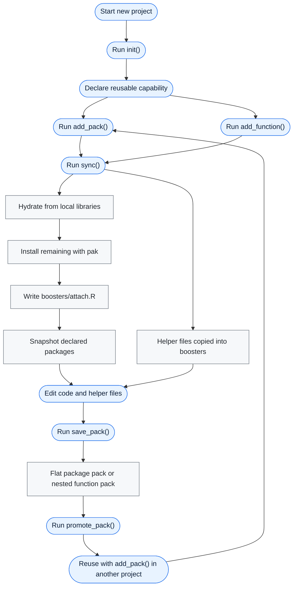

`boosterpak` installs reusable R project packs: typed bundles of package
dependencies, optional source specs, startup attachment intent, and
helper-function sidecars that make a project usable without turning it into a
package. It is less than a package, but more than a fistful of copied files.

`boosters.toml` is the project-local control file for those packs. It is not a
general dependency-manifest standard and `boosterpak` does not depend on one.
`pak` remains the installer, `renv` remains the lockfile and default
project-library layer, and `boosterpak` sits above them as a small
capability-bundle layer for reusable setup conventions. Existing projects can
instead apply packs to an active user or site library without creating a
project-local `renv` environment.

A project declares the packs it wants in `boosters.toml`; `boosterpak::sync()`
resolves those packs, hydrates plain-name packages from local libraries when
possible, and installs anything still missing into the selected package
library. It also writes `boosters/attach.R` with explicit startup
`library()` calls for packages intended to be attached.
Packs can also carry exact copied helper files, so a useful project setup can be
reused without separating "packages" from customized `boosters/fn_*.R` files.

## Typical workflow



In practice, initialize once, add pack and function capability intent over time,
run `sync()` whenever the project should match that intent, then save and promote
a pack when the setup is worth reusing.
For an already initialized repo clone, skip `init()` and use the restore path:
`renv::restore()`, restart R, then `boosterpak::sync(mode = "restore")`.

A pack is deliberately typed and reviewable. Today that means packages, optional
`[sources]`, optional `attach`, optional copied helper functions, and optional
extension from other packs. It is not an arbitrary file sprinkler; project-specific
mess stays in the project, and only reusable setup invariants belong in a pack.

## 1. Install pak

```{r}
#| echo: true
#| eval: false
install.packages("pak")
```

## 2. Install boosterpak

```{r}
#| echo: true
#| eval: false
pak::pkg_install("seanthimons/boosterpak")
```

## 3. Initialize the project

```{r}
#| echo: true
#| eval: false
boosterpak::init(renv = "yes", rprofile = "yes")
```

This creates:

- `boosters.toml`
- `boosters/packs/`
- `air.toml`, when enabled by settings
- a `.Rprofile` startup hook, when requested

The generated `boosters.toml` includes `boosterpak` itself in
`[extras].declared`, so the package needed to run `sync()` is also captured in
project intent and the project lockfile. With `renv = "yes"`, `init()`
bootstraps only `renv`, `pak`, and `boosterpak` into the project library and
creates the initial lockfile when `auto_snapshot = true`.

In non-interactive sessions, use explicit `renv` and `rprofile` arguments. The
default `"ask"` mode never silently changes `.Rprofile` when user confirmation
would be required.

On glibc Linux, `init()` also configures Posit's portable Linux binaries, so
distributions that Package Manager does not list, such as Fedora, install
binaries instead of compiling from source. See "Linux binary packages" below.

## 4. Sync the project

```{r}
#| echo: true
#| eval: false
boosterpak::sync()
```

Apply mode is additive. With the default renv-library strategy, it hydrates
plain-name missing packages from renv-discoverable local libraries, installs
anything still missing with `pak`, and materializes missing bundled or installed
helper functions. It writes `boosters/attach.R` on every run. When
`auto_snapshot` is `true`, the default, it also snapshots with `renv`. Use
`hydrate = FALSE` to skip local reuse for stricter first-run installs.

## Linux binary packages

CRAN publishes only source packages for Linux. Posit Package Manager builds
Linux binaries from them, but serves them from distribution-specific URLs such
as `https://packagemanager.posit.co/cran/__linux__/jammy/latest`, which exist
only for the distributions Package Manager lists. The generic URL
(`https://packagemanager.posit.co/cran/latest`) serves source, so on other glibc
distributions, for example Fedora, every package installs from source.

Posit's
[portable Linux binaries](https://posit.co/blog/introducing-portable-linux-r-binary-packages)
(`manylinux_2_28`) use one binary build for all glibc distributions. On glibc
Linux, boosterpak rewrites every Package Manager repository URL in `repos` (and in
`renv.config.repos.override`) that has this form:

```text
https://packagemanager.posit.co/cran/latest
  -> https://packagemanager.posit.co/cran/__linux__/manylinux_2_28/latest
```

Package Manager only serves binaries from `__linux__` URLs to clients that
identify as R, so boosterpak also sets `options(HTTPUserAgent = ...)`. For the
`"curl"` and `"wget"` download methods, which ignore `HTTPUserAgent`, it appends
the matching `User-Agent` header to `options(download.file.extra)` and keeps any
value already there.

The `.Rprofile` repository lines keep the generic URL, so one `.Rprofile` works
on Windows, macOS, and Linux. A guarded line after them performs the rewrite on
glibc Linux only, at startup. A second copy follows the renv activation line,
because `renv::load()` resets the repositories to the lockfile URLs. It runs only
while renv's Package Manager handling is on, so the lockfile keeps the generic
URL. The re-applied block also restores the Package Manager URL on every OS when
`renv::load()` left a default CRAN mirror, such as `https://cran.rstudio.com`, in
`repos`. Custom mirrors are left alone. Distribution-specific URLs such as
`.../cran/__linux__/noble/latest` are left alone. Rerun `init()` or `upgrade_project()`
to replace the line written by an earlier boosterpak version.

**When it applies.**

- R runs on glibc Linux, meaning `R.version$os` is `"linux-gnu"`. That is the
  only thing boosterpak checks. musl systems such as Alpine report
  `"linux-musl"` and are skipped.
- The binaries themselves are built on RHEL 8 for x86_64 and ARM64 and need
  glibc 2.28 or newer (check with `ldd --version`). boosterpak does not test for
  this, so on an older or unusual system use the opt-out below.
- The repository URL is `<host>/<repo>/latest` or `<host>/<repo>/<YYYY-MM-DD>`,
  with no trailing slash, on
  `packagemanager.posit.co`, `packagemanager.rstudio.com`, or `p3m.dev`.
- For a self-hosted Package Manager, boosterpak also recognizes the host of
  `BOOSTERPAK_PPM_REPO` and hosts listed in `BOOSTERPAK_PPM_HOSTS` or
  `options(boosterpak.ppm_hosts = c(...))`. The server needs `manylinux_2_28`
  enabled, or installs fail with 404 errors.

**Things to know.**

- Portable Linux binaries are a public preview from Posit.
- Binaries bundle their system libraries. Each package carries an
  `sbom.cdx.json` and a `Built/SystemLibs` field in its `DESCRIPTION`. An
  installed package does not update its bundled libraries, so reinstall a
  package from a snapshot that contains the rebuilt binary to pick up a
  security fix.
- When Package Manager has no binary for a package, it serves source without an
  error.
- `download.file.extra` is only set when `download.file.method` is already
  `"curl"` or `"wget"` as the managed line runs. A user agent passed through
  curl's `-A` or wget's `-U` is not detected.
- Package Manager serves packages through a redirect that R's `"curl"` method
  does not follow on its own, so installs fail unless `download.file.extra`
  includes `-L`. Posit recommends `-fsSL`. boosterpak adds only the user agent
  header, never curl flags. Set your own flags earlier in `.Rprofile` than the
  managed block and boosterpak appends the header after them; a later
  assignment replaces the header.

**Check that binaries are served.**

```{r}
#| echo: true
#| eval: false
boosterpak::check_binary_repos()
```

`check_binary_repos()` requests one small package from each Package Manager
repository, using the session's user agent, and reports the `X-Package-Type` and
`X-Package-Binary-Tag` headers. It warns for any repository serving source, and
when `download.file.method` is `"curl"` without `-L` in `download.file.extra`,
because curl installs would then fail even though the check passes. In an
install log, a binary appears as `* installing *binary* package 'cli' ...`.

**Opt out.** Set `BOOSTERPAK_CONFIGURE_REPOSITORIES=false`, for example in
`~/.Renviron`, to stop boosterpak from changing repository settings. The managed
`.Rprofile` line checks it too, so projects that already contain the line stop
rewriting without edits. Repository lines already in `.Rprofile` keep pointing at
the generic Package Manager URL, so distributions Package Manager does not list
compile from source again. `options(boosterpak.configure_repositories = FALSE)`
only stops boosterpak's own repository configuration in the R session; it does
not affect a line already in `.Rprofile`, and the environment variable wins if
both are set. With repository setup opted out but install-policy setup still on,
`upgrade_project()` removes the managed repository lines from `.Rprofile`,
because boosterpak then has no repository setup to write back. The install-policy
lines are kept. `init()` does the same when the install-policy lines are missing.
If `BOOSTERPAK_CONFIGURE_INSTALL_POLICY` is off as well, neither command writes or
removes setup lines.

## Safely deinitialize a project

Call `deinit()` without component arguments in an interactive session to see a
single picker containing only components that have something to clean up. All
actionable components are preselected. After selection, `deinit()` displays the
exact project paths and `.Rprofile` changes and asks for one final confirmation.

```{r}
#| echo: true
#| eval: false
boosterpak::deinit()
```

Automation must opt out of prompts with `force = TRUE`. Supplying any component
argument skips the picker and honors all five logical selectors:

```{r}
#| echo: true
#| eval: false
boosterpak::deinit(
  renv = TRUE,
  boosters = TRUE,
  rprofile = TRUE,
  lockfile = TRUE,
  air = TRUE,
  force = TRUE
)
```

The selectors are independent, so partial cleanup is explicit. For example,
the following removes only the lockfile after confirmation:

```{r}
#| echo: true
#| eval: false
boosterpak::deinit(
  renv = FALSE,
  boosters = FALSE,
  rprofile = FALSE,
  lockfile = TRUE,
  air = FALSE
)
```

The cleanup is conservative. `.Rprofile` itself and unrelated user lines are
always retained. A renv activation line is removed only when both `renv` and
`rprofile` are selected and the activation is a recognized whole-line
expression. Edited or ownership-unknown `air.toml` files, malformed managed
startup markers, user/global packs, active user libraries, and session options
are preserved. If the removed renv library is active, restart R before
continuing. Repeating the same cleanup is an unprompted no-op.

## Use an active library without a project renv

For an existing live project that should keep using its current R libraries,
initialize without creating a project-local `renv` environment:

```{r}
#| echo: true
#| eval: false
boosterpak::init(renv = "no", rprofile = "yes")
```

Then edit the generated setting in `boosters.toml`:

```toml
[settings]
library = "active"
```

`boosterpak::sync()` and eager pack mutations now detect and install packages
in the first writable entry of `.libPaths()`. Source-specific install specs,
helper functions, and startup attachment work normally. Active-library apply
mode skips hydration and snapshotting and does not create `renv/` or
`renv.lock`. The same behavior can be selected for one call with
`boosterpak::sync(library = "active")`.

The `renv` package remains an installation dependency because boosterpak also
supports lockfile restoration, but active-library mode does not create or load
a project-local renv environment. `sync(mode = "restore")` remains the separate
renv lockfile workflow.

## Add a Pack

```{r}
#| echo: true
#| eval: false
boosterpak::add_pack("example")
```

The `example` pack installs `cli`. `add_pack()` preserves unrelated comments and
sections in `boosters.toml` while updating `[packs].declared`.
For the analysis baseline of `fs`, `here`, `janitor`, `rio`, core tidyverse
packages, `scales`, `glue`, `digest`, `skimr`, and bundled helper functions,
add the `eda` pack explicitly:

```{r}
#| echo: true
#| eval: false
boosterpak::add_pack("eda")
```

If the pack carries helper functions, `add_pack()` also copies the bundled
`fn_*.R` files into `boosters/` and refuses to overwrite existing function files
unless `overwrite_functions = TRUE`.

Packs can mix ordinary CRAN package names with package-specific source specs.
Declare every package in `packages`, then use `[sources]` only for packages that
should install from another source:

```toml
name = "plotting"
description = "Plotting packages from CRAN and GitHub."
packages = ["ggplot2", "patchwork", "ggtext"]

[sources]
"ggtext" = "wilkelab/ggtext"
```

Here, `ggplot2` and `patchwork` can hydrate or install by package name, while
`ggtext` skips hydration and uses the GitHub source spec.

Package attachment is a startup layer, not installation intent. By default a
pack attaches its direct `packages`. The pack's `attach` field and the top-level
`[attach]` table change that. A pack can also set `attach_mode = "interactive"`
so that its packages attach only in interactive sessions. The section "Startup
cost and attach trimming" below covers the options and what they cost at every
R start.

### Remove a pack

```{r}
#| echo: true
#| eval: false
boosterpak::remove_pack("example")
```

`remove_pack()` removes the pack from `[packs].declared` and regenerates
`boosters/attach.R`, also with `sync = FALSE`, so the removed pack's packages
stop attaching at startup. It deletes the `[settings.packs.<name>]` section of
each pack that is no longer resolved, together with its values. Sections of
packs that are still resolved, including packs that another declared pack
extends, are kept. Helper files are kept too, unless you pass
`remove_functions = TRUE`. That option deletes only files that still match the
pack's copy, so edited helper files survive.

The packages stay in `renv.lock` and in the project library. The removal
message lists any that remain. To drop them, run `renv::snapshot()` to update
the lockfile and `renv::remove()` to uninstall them.

## Add a Helper Function

```{r}
#| echo: true
#| eval: false
boosterpak::add_function("ni")
```

Helper functions are materialized as `boosters/fn_*.R` files and tracked in
`[functions].installed`. They are ordinary project files, so you can edit them
after materialization. `sync()` restores missing installed helper files, but it
does not overwrite local edits.

## Startup cost and attach trimming

Every R session that starts in the project runs `.Rprofile`. The managed
startup hook then sources `boosters/attach.R` and each `boosters/fn_*.R` file.
Worker processes that R starts from the project directory run it too, unless
they start with `--vanilla` or `--no-init-file`. Each attached package therefore
loads on every one of those starts. If startup is slow, trim attachment first.
Trimming does not change what is installed.

`boosters/attach.R` attaches each package on its own. A package that is not
installed does not stop the others. boosterpak counts the missing packages and
prints one message that names them and points to `renv::restore()`. The helper
files still load, because the hook wraps `attach.R` and each `fn_*.R` file in
its own `try()`.

These settings control what attaches:

- `[attach] enabled = false` attaches nothing. The managed `boosters/attach.R`
  is removed. Packages stay installed, and helper files still load.
- `[attach] exclude = [...]` keeps the listed packages installed but never
  attached. It overrides every other attach rule. Packages listed in
  `[exclude] declared` are also left out of `attach.R`.
- `attach = false` in a pack installs that pack's packages without attaching
  them. `attach = ["pkg1", "pkg2"]` attaches only the listed packages. These
  values apply to the pack's own packages. Packages attached by a pack that the
  pack extends still attach.
- `attach_mode = "interactive"` in a pack keeps that pack's packages installed
  and attaches them only when R is interactive. Workers, `Rscript`, and document
  renders skip them. The key goes above the first table header in the pack file
  (`[sources]`, `[settings]`, `[hooks]`), because a key below a table header belongs
  to that table and is not read as a pack key. A
  package that another pack or `[attach].declared` also requests without the
  interactive mode still attaches on every start.
- `[attach] declared = [...]` attaches the listed packages. The workflow packages
  `pak`, `renv`, and `boosterpak`, and any package listed in `[extras].declared`,
  do not attach unless they are listed here.

A package attaches when a declared pack or `[attach].declared` lists it, and
neither `[attach].exclude` nor `[exclude].declared` removes it. A package that
only an `attach_mode = "interactive"` pack lists attaches only in interactive
sessions. After you edit
`[attach]` or a pack's `attach` field, run `boosterpak::sync()` or
`boosterpak::write_attach()` to regenerate `boosters/attach.R`. Edit
`boosters.toml`, not the generated file.

For a targets pipeline, list the packages the targets use in
`tar_option_set(packages = ...)`. Each worker then loads those packages for its
targets, whatever `attach.R` contains, so the pipeline keeps working when attach
trimming removes a package. `attach.R` still runs on every worker, so trim attach
as well when startup time matters.

Interactive-only packages go into `attach.R` inside an `if (interactive())` block.
`interactive()` is `FALSE` in `Rscript`, in a Quarto or knitr render (including
RStudio's Render button), and in targets, crew, and callr workers. Code that calls
a function from such a package without a namespace prefix works at the console
and fails when a document renders or a pipeline runs, so write `here::here()` or
`fs::path()` in code that must run everywhere.

The shipped `scaffold-analysis` pack uses `attach_mode = "interactive"`. Its
helper calls only `fs::` functions, so workers do not need `fs` or `here`
attached. A project that already has its own copy of a pack keeps that copy,
because `add_pack()` and `sync()` never overwrite files in `boosters/packs/`.
Such a project still attaches those packages on every start until the copy gets
`attach_mode = "interactive"` above the first table header, or until the copy is deleted and
`boosterpak::sync()` copies the current pack again.

`status()` shows what is attached and where it comes from. See
[Inspect status](#inspect-status) below.

## Project version record

`[project].boosters_version` in `boosters.toml` records the boosterpak version
the project was last migrated with. It is a record, not a lock:

- `init()` writes it once its `.Rprofile` step has run. With `rprofile = "no"`,
  or when the prompt is declined, the record is not written.
- `upgrade_project()` writes it after a real run that reports no warnings.
- `sync()` does not change it.

`status()` warns when the record is older than the installed boosterpak. A missing
record is reported as "no version recorded" without a warning, and
`upgrade_needed` is still `TRUE`. The warning says to run `boosterpak::upgrade_project(dry_run = TRUE)`
first, then `boosterpak::upgrade_project()`. Review the result with `git diff`
before you commit it. The upgrade itself is covered in
`vignette("upgrading-a-project", package = "boosterpak")`.

## Capture and Reuse

```{r}
#| echo: true
#| eval: false
boosterpak::save_pack("project_baseline")
boosterpak::promote_pack("project_baseline")
```

`save_pack()` captures the resolved package set and, by default, helper functions
listed in `[functions].installed`. Use `functions = "all"` to capture every
`boosters/fn_*.R` file, `functions = "none"` for a flat package-only pack, or a
character vector for specific function names. `promote_pack()` and
`demote_pack()` copy flat package-only packs as single files and nested
function-bearing packs as whole directories.

## Related Tools and Boundaries

`boosterpak` is intentionally narrow:

- `pak` resolves and installs package specs.
- `renv` owns project libraries, lockfiles, and exact version restoration.
- `boosterpak` owns reusable project capability packs: dependencies plus the
  small helper files, attachment choices, and setup conventions that are too
  project-shaped for a package and too reusable for copy-paste.

That boundary is the point. `boosterpak` uses TOML for its own pack and project
config, but it is not trying to be a general project requirements format. For
how `boosterpak` compares with `rix`, `rv`, `uvr`, and `ir`, see
[Choosing a setup](choosing-a-setup.html).

## Restore Exact Versions

```{r}
#| echo: true
#| eval: false
boosterpak::sync(mode = "restore")
```

Restore mode is lockfile-exact: it restores through `renv::restore()` and does
not hydrate.

For the full restore-mode contract and the clone-to-working walkthrough on a
new machine, including the bootstrap order when `boosterpak` is not installed
yet, see `vignette("restoring-a-project", package = "boosterpak")`.

## Troubleshooting boosterpak 0.5 init projects

If a project was initialized with boosterpak 0.5 and, after restart,
`boosterpak` is no longer found, follow the bootstrap recipe under
"Troubleshooting: boosterpak absent from the lockfile" in
`vignette("restoring-a-project", package = "boosterpak")`.

## Inspect status

```{r}
#| echo: true
#| eval: false
boosterpak::status()
boosterpak::list_packs()
```

`status()` reports whether the project config exists and validates, what packs and
packages resolve, whether project-local `renv` appears active, whether
`renv.lock` exists, whether `boosters/attach.R` exists, and whether `.Rprofile`
contains the startup hook.

For startup attachment, `status()` prints each attached package with the pack
that requested it, or `[attach].declared` for packages listed there, followed by
`attached on every R start (including workers): N packages`. Packages from
interactive-only packs are left out of that count and listed after it as
`M more only in interactive sessions`. When the installed
boosterpak is newer than the `boosters_version` record, it warns and names the
upgrade commands. When `renv.lock` exists on Linux, it suggests
`check_binary_repos(lockfile = "renv.lock")`. When the project declares GitHub
sources, it reports whether a GitHub token is visible, as `TRUE` or `FALSE`. It
never prints the token.

`status()` does not use the network. To confirm that Package Manager serves
binaries rather than source, run `boosterpak::check_binary_repos()`; see "Linux
binary packages" above.
